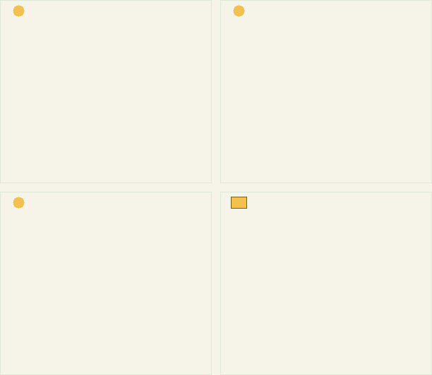
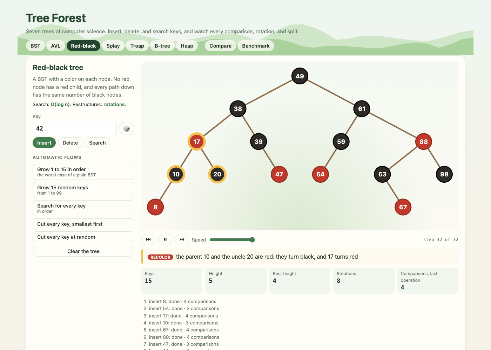
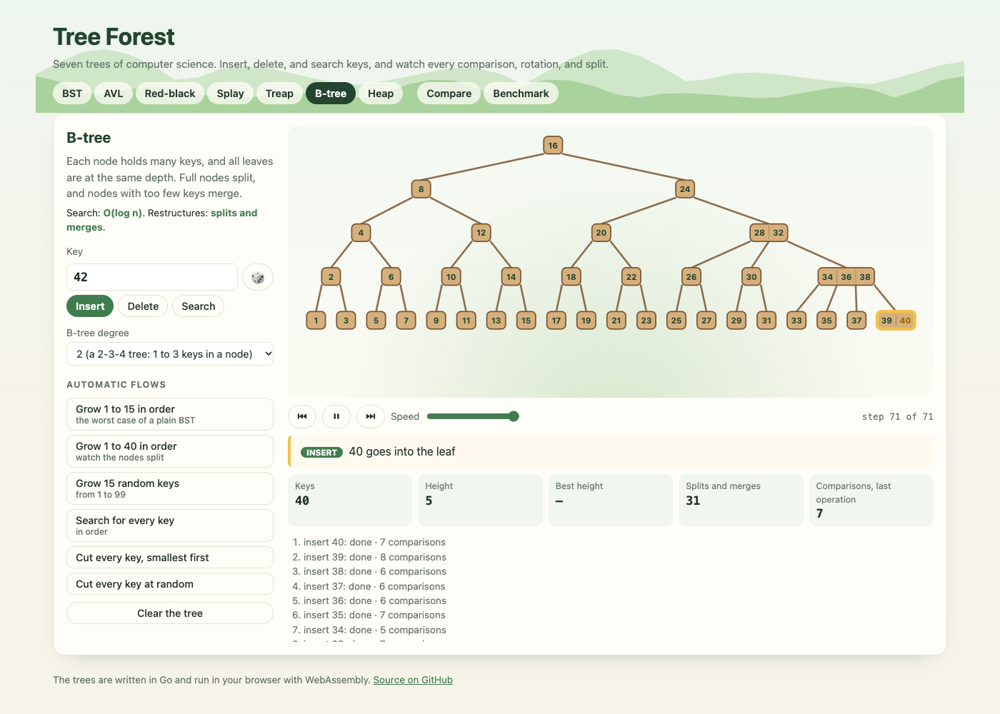
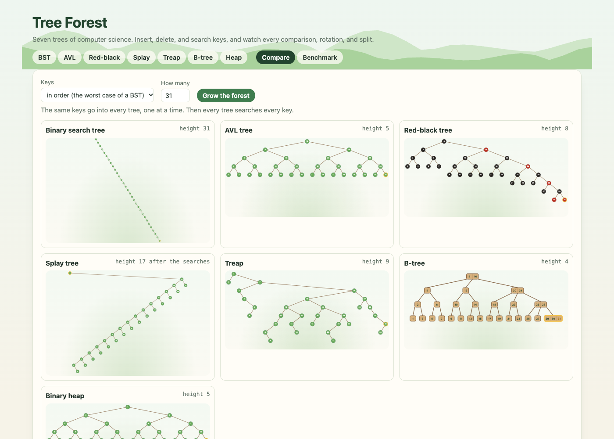

# Tree Forest

Seven classic trees of computer science, written in Go: a binary search tree, an AVL tree, a red-black tree, a splay tree, a treap, a B-tree, and a binary heap. A web page runs them in your browser with WebAssembly. You can insert, delete, and search keys, and watch every comparison, rotation, recolor, split, and merge, step by step.

[](https://github.com/rahelmartim/tree-forest/actions/workflows/ci.yml)
[](https://rahelmartim.github.io/tree-forest/)



The keys go in order. Top left is the BST, which becomes a line. Top right is the AVL tree, bottom left the red-black tree, and bottom right the B-tree. To try it, open the [live demo](https://rahelmartim.github.io/tree-forest/).

## The page

The page has one tab for each tree, and two tabs that compare them.

| Tab | What it does |
| --- | --- |
| A tree | Insert, delete, or search a key. The player shows each step with a note, such as "rotate left at 1: 2 goes up". It also has automatic flows, such as "Grow 1 to 15 in order" and "Cut every key at random". |
| Compare | The same keys go into all seven trees, one at a time. A table shows the height, the restructures, and the comparisons in a search. |
| Benchmark | Each tree inserts, searches, and deletes up to 100,000 keys. A table and charts show the time of each operation and the height. |



### What you can change

- The key, from 0 to 999, or a random key.
- The speed of the player. At speeds 8 to 10, the player skips the comparisons, so that long flows stay short.
- The degree of the B-tree: 2 (a 2-3-4 tree), 3, or 4.
- The order of the keys in Compare and Benchmark: in order, random, in reverse order, or zigzag.
- The number of keys in Compare (3 to 63) and in Benchmark (1,000 to 100,000).

To go back or forward one step, use the player buttons. The address of the page opens a tab, such as `#btree`.



## The trees

| Tree | The rule | Search | It keeps its balance with |
| --- | --- | --- | --- |
| Binary search tree | Smaller keys go left, bigger keys go right. | O(height): O(n) in the worst case | nothing |
| AVL tree | The heights of the two subtrees of every node differ by at most 1. | O(log n) | rotations |
| Red-black tree | No red node has a red child, and every path down has the same number of black nodes. | O(log n) | rotations and recolors |
| Splay tree | Each key that it touches moves to the root. | O(log n), on average over many operations | rotations (zig, zig-zig, zig-zag) |
| Treap | A BST by key, and a heap by a random priority. | O(log n), expected | rotations |
| B-tree | A node holds from t-1 to 2t-1 keys, and all leaves are at the same depth. | O(log n) | splits, merges, and borrows |
| Binary heap | Each parent is smaller than its children. It is a complete tree in an array. | O(n) for any key, O(1) for the smallest | swaps |

The binary trees share one node type with parent links, and one pair of rotations (`trees/tree.go`). Each operation can record its steps, and each step holds a snapshot of the tree. The page plays the snapshots and slides each key from its old place to its new place.



## Getting started

You need Go 1.24 or later and Python 3.

```bash
make serve
```

Then open http://localhost:8080. To use another port, run `make serve PORT=8090`.

### In the terminal

```bash
go run ./cmd/forest -tree avl -insert 1,2,3,4,5,6,7
go run ./cmd/forest -tree redblack -insert 1,2,3,4,5 -delete 2 -steps
go run ./cmd/forest -tree btree -insert 1,2,3,4,5,6,7,8,9
make bench   # the Go benchmarks
```

The terminal prints the tree on its side: the root is on the left, and bigger keys are above.

### Use the package

```go
t := trees.NewAVL()
for _, k := range []int{1, 2, 3} {
	t.Insert(k)
}
rec := t.Record(true) // keep the steps of the next operations
t.Delete(2)
for _, s := range rec.Steps {
	fmt.Println(s.Kind, s.Note)
}
```

## Tests

```bash
make test                                      # Go tests with the race detector
make web && node --test web/test/forest.test.js  # browser tests (needs Chrome)
```

| Test | What it covers |
| --- | --- |
| `trees` | Every tree against a Go map, after each of 8,000 random operations, with its invariants checked each time. Keys in order, the splay root, heap sort, the B-tree degrees, the steps, and the benchmark. |
| `web/test` | In a headless Chrome: an AVL rotation, the player, and a missing key. The red-black colors, a BST line, B-tree splits, and heap sort. A splay to the root, Compare, Benchmark, and the address. |

The invariants are these:

- **AVL:** the heights and the balance of every node.
- **Red-black:** a black root, no red node with a red child, and the same number of black nodes on every path.
- **Treap:** the order of the priorities.
- **B-tree:** the number of keys in every node, and all leaves at one depth.
- **Heap:** each parent is smaller than its children.
- **All binary trees:** the order of the keys and the parent links.

## Project structure

```text
trees/            # The seven trees, the record of steps, and the benchmark
cmd/forest/       # A tree in the terminal
cmd/forest-wasm/  # The WebAssembly build for the page
cmd/forestgif/    # The GIF at the top of this file (make gif)
web/              # The page, and its browser tests
docs/             # The GIF and the screenshots
```

## License

This project uses the MIT license. Read the [LICENSE](LICENSE) file for the full text.
